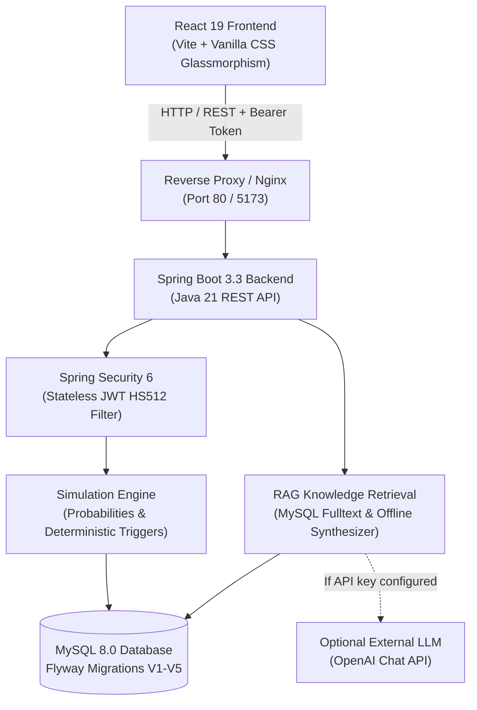
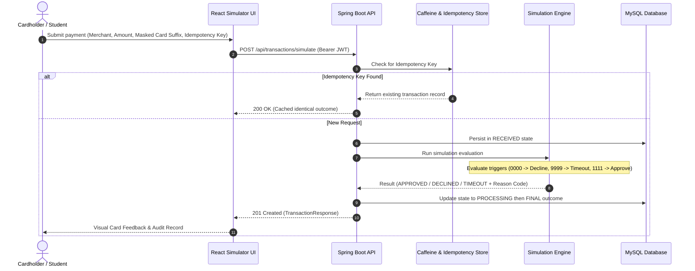

# 💳 Card Payment Transaction Simulator (CPTS)

> **A production-style, educational full-stack payment processing simulator built with Java 21, Spring Boot 3.3, React 19, MySQL 8, JWT Authentication, and an offline-capable RAG AI Learning Assistant.**

[](https://spring.io/projects/spring-boot)
[](https://react.dev/)
[](https://openjdk.org/projects/jdk/21/)
[](https://www.mysql.com/)
[](LICENSE)

---

## 📖 Executive Summary

Modern software applications constantly interface with payment gateways (Stripe, Razorpay, Adyen, Visa/Mastercard). However, the internal lifecycle of an authorization transaction—how risk rules trigger declines, how timeouts happen, how idempotency protects against double-charges, and how authorization contrasts with settlement—is frequently obscured behind third-party SDKs.

The **Card Payment Transaction Simulator** is an educational, production-grade application designed for computer science students, junior engineers, and full-stack architects. It simulates the end-to-end payment pipeline with realistic latency, deterministic outcome triggers, idempotency safeguards, and an embedded **Retrieval-Augmented Generation (RAG)** tutor.

---

## 🏛️ System Architecture



### Transaction Processing Lifecycle



---

## 🚀 Key Features

### 1. Payment Simulation Engine
- **Deterministic Test Triggers**:
  - Card ending in `1111` ➡️ Always **APPROVED**
  - Card ending in `0000` ➡️ Always **DECLINED** (`TEST_DECLINE`)
  - Card ending in `9999` ➡️ Always **TIMEOUT** (`TEST_TIMEOUT`)
  - Amount ending in `.99` (e.g. `49.99`) ➡️ Always **DECLINED** (`AMOUNT_TRIGGER_DECLINE`)
  - Amount exceeding `1,000,000.00` ➡️ Always **DECLINED** (`AMOUNT_EXCEEDED`)
- **Probabilistic Fallback**: Configurable approval (75%), decline (20%), and timeout (5%) distributions.
- **Idempotency Protection**: Client-generated UUID keys prevent accidental double billing when network retries occur.

### 2. High-End Fintech UI (React 19 + Vite)
- **Design System**: Midnight Sapphire luxury dark palette with glassmorphism, glowing status badges, and responsive CSS Grid.
- **3D Interactive Virtual Card**: Renders EMV chip, contactless wave, cardholder name, expiry, and masked numbers in real time as user types.
- **Multi-Stage Visual Stepper**: Displays live progress through `RECEIVED` ➡️ `PROCESSING` ➡️ `FINAL OUTCOME`.
- **Audit Ledger & CSV Export**: Advanced filtering by date, merchant name, amount range, and instant one-click CSV download.

### 3. RAG-Powered AI Payment Tutor
- **Retrieval-Augmented Generation**: Queries educational documents stored in MySQL (`knowledge_documents` table seeded by Flyway).
- **Graceful Fallback Mode**: Functions 100% offline out-of-the-box without an OpenAI key, synthesizing structured educational responses and citing internal documentation.
- **Multi-Turn Chat History**: Preserves persistent conversation threads per user.

### 4. Enterprise Security & Architecture
- **Stateless JWT Authentication**: Tokens signed with HS512 (64-byte key) containing user claims and role.
- **Role-Based Access Control (RBAC)**: Enforces `USER` and `ADMIN` separation; users can only view their own transactions; admins access global audit logs and account governance.
- **In-Memory Rate Limiting**: Sliding-window limiter defends against login brute-force attacks and transaction spamming.
- **Flyway Database Migrations**: Versioned SQL migrations (`V1` through `V5`) ensure reproducible schemas and automated seeding.

---

## 🛠️ Technology Stack

| Domain | Technology | Version | Purpose |
| :--- | :--- | :--- | :--- |
| **Backend Runtime** | Java OpenJDK | 21 | High-performance modern Java platform |
| **Framework** | Spring Boot | 3.3.5 | REST API, DI, Security, JPA |
| **Security** | Spring Security + JJWT | 0.12.6 | Stateless JWT authentication & RBAC |
| **Database** | MySQL | 8.0 | Transaction records, users, RAG knowledge |
| **Migrations** | Flyway | 10.x | Automated versioned schema management |
| **Caching** | Caffeine | 3.x | In-memory query caching |
| **API Docs** | SpringDoc OpenAPI | 2.6.0 | Swagger UI and OpenAPI 3 schema |
| **Frontend Runtime**| React | 19.x | Component-based interactive UI |
| **Build Tool** | Vite | 8.x | Ultra-fast HMR and bundling |
| **Charts** | Recharts | 3.x | Donut status distribution & trend area charts |
| **Icons** | Lucide React | 1.x | Lightweight SVG icon system |
| **Containers** | Docker & Compose | Multi-stage | Reproducible local & cloud execution |

---

## 💻 Quick Start Options

### Option A: 1-Click Docker Compose (Recommended)
Ensure Docker Desktop is running:
```bash
docker compose up --build
```
- Frontend: **http://localhost**
- Backend: **http://localhost:8080**
- Swagger UI: **http://localhost:8080/swagger-ui.html**

### Option B: Local Development

1. **Start MySQL 8**:
   Create database `cpts_db` on `localhost:3306` with user `cpts_user` and password `cpts_password`.

2. **Start Backend**:
   ```bash
   cd backend
   # Windows (Maven Wrapper - no pre-installed Maven required):
   .\mvnw.cmd spring-boot:run
   # Linux / macOS (Maven Wrapper):
   ./mvnw spring-boot:run
   # Or with system Maven:
   mvn spring-boot:run
   ```

3. **Start Frontend**:
   ```bash
   cd frontend
   npm install
   npm run dev
   ```
   Open **http://localhost:5173**.

---

## 📚 Educational Comparison: Simulator vs Production Gateways

| Feature | CPTS Educational Simulator | Production Gateway (Stripe / Razorpay) |
| :--- | :--- | :--- |
| **Financial Settlement** | ❌ Simulated (No real funds transferred) | ✅ Automated ACH / SEPA / FedNow clearing |
| **Card Data Security** | ✅ Masked strings only (`**** 1234`) | ✅ Strict Level 1 PCI DSS Tokenization Vaults |
| **Bank Connections** | ❌ Deterministic internal simulation engine | ✅ Direct ISO 8583 interfaces to Visa/Mastercard |
| **Idempotency** | ✅ UUID unique constraint & cache return | ✅ Global distributed Redis idempotency locks |
| **Outcome Transparency** | ✅ Shows internal reason codes & timings | ⚠️ Limited reason codes returned to merchants |

---

## 🧪 Automated Testing

### Backend Tests (17 Automated Tests)
Run the full suite of backend unit and integration tests using Maven wrapper:

```bash
cd backend
# Windows:
.\mvnw.cmd test
# Linux / macOS:
./mvnw test
```

All 17 automated tests evaluate:
- **Simulation Engine** (6 tests): Deterministic card triggers (`0000`, `9999`, `1111`), amount rules (`.99`, limit exceeded), reference format.
- **Security & JWT** (3 tests): Cryptographic HS512 JWT generation, claims extraction, expired/tampered token rejection.
- **Authentication & RBAC** (4 tests): Registration, duplicate email rejection, login, unauthorized endpoint protection.
- **Transaction Services** (4 tests): Persistence, idempotency deduplication, cross-user isolation, currency validation.

### Frontend Tests (3 Automated Tests)
Run the frontend unit tests with Vitest:

```bash
cd frontend
npm test
```
Evaluates Bearer JWT header attachment, 401 token clearing, and 204 No Content response handling.

---

## ☁️ Cloud Deployment (Render)

Refer to [DEPLOYMENT.md](file:///c:/JFS/CARD_PAYMENT_TRANSACTION_SIMULATOR/DEPLOYMENT.md) for step-by-step instructions on deploying to Render using our included `render.yaml` Blueprint or manual web services.
